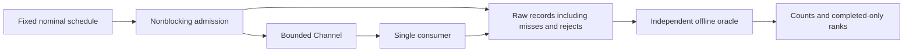

# Tail-Latency Evidence Bench

A small C#/.NET experiment that keeps the missing work visible. The generator follows a fixed open-loop schedule. A deliberately slow consumer fills a bounded channel; rejections and unfinished admissions remain in the result beside completed-only latency ranks.

Offline synthetic work only. No NIC, wire, exchange, cross-host latency, production HFT capacity or speed-improvement claim.

## Start with the decisions and their proofs

| Decision | Evidence |
| --- | --- |
| Do not hide overload by blocking the generator | Same nominal schedule/seed for healthy and slow cases; actual admissions/rejections recorded |
| Do not treat missing work as fast work | Generator misses, rejections and cutoff-censored admissions are separate counts |
| Do not invent a tail from a small sample | Exact raw-sample ranks; p99.9 suppressed below 100,000 completions |
| Do not silently lose measurement records | A requested run beyond the record cap returns INCOMPLETE before starting, without quantiles |
| Do not trust the producer's own statistics | Independent Python integer/Fraction oracle and eight corrupted-data counterexamples |

## Run the preview

Published preview: [`v0.1.0-preview.1`](https://github.com/pouriajamali/tail-latency-evidence-bench/releases/tag/v0.1.0-preview.1). Download **[Windows x64](https://github.com/pouriajamali/tail-latency-evidence-bench/releases/download/v0.1.0-preview.1/tail-latency-evidence-bench-v0.1.0-preview.1-win-x64.zip)**, **[Linux x64](https://github.com/pouriajamali/tail-latency-evidence-bench/releases/download/v0.1.0-preview.1/tail-latency-evidence-bench-v0.1.0-preview.1-linux-x64.tar.gz)** or [source](https://github.com/pouriajamali/tail-latency-evidence-bench/releases/download/v0.1.0-preview.1/tail-latency-evidence-bench-v0.1.0-preview.1-source.zip). Get the [checksums](https://github.com/pouriajamali/tail-latency-evidence-bench/releases/download/v0.1.0-preview.1/SHA256SUMS.txt), [checksum signature](https://github.com/pouriajamali/tail-latency-evidence-bench/releases/download/v0.1.0-preview.1/SHA256SUMS.txt.sig) and [public key](https://github.com/pouriajamali/tail-latency-evidence-bench/releases/download/v0.1.0-preview.1/SIGNING-PUBLIC-KEY.pub); verify downloaded bytes with [PROVENANCE.md](PROVENANCE.md) before executing them. Local builds and CI artifacts are separate from published releases.

From the extracted Windows x64 package:

```powershell
.\tail-evidence.exe --help
python tools/native_demo.py --cli tail-evidence.exe --out artifacts/demo
if ($LASTEXITCODE -ne 0) { throw 'Evidence validation failed' }
Get-Content artifacts/demo/receipt.json
Get-Content artifacts/demo/oracle.json
```

From the extracted native Linux x64 package:

```sh
./tail-evidence --help &&
python3 tools/native_demo.py --cli ./tail-evidence --out artifacts/demo &&
cat artifacts/demo/receipt.json
```

The self-contained CLI needs no SDK or online service. Python 3.12+ runs the independent verifier; OpenSSH verifies package provenance. Windows and Linux run their native CLI. Existing WSL can run the Linux package; its measurements are VM observations, never bare-metal or cross-platform speed evidence.

The demo runs three healthy/slow pairs, 5,000 planned requests each, a 100 microsecond period, channel capacity 64 and a fixed 20 millisecond drain. All cases use the same offered schedule, seed, cutoff/deadline settings and executable. The service loop's configured busy-wait target changes from 10 to 500 microseconds per work unit; this is a controlled overload fixture, not an optimized application. Sample values vary with OS load, scheduling, virtualization, clock and JIT. CI checks arithmetic/chronology/caps, without performance pass thresholds.

Use a new output directory for every attempt. Raw CSV, summary JSON and independent receipts are retained. COMPLETE means complete accounting; it does not mean every request was attempted, admitted or successful.

## Read the result before the percentile

```text
planned  = generatorMissed + attempted
attempted = admitted + rejected
admitted = completedAtCutoff + censoredAtCutoff
completedAtCutoff = success + failure
```

Generator lateness and deadline flags are orthogonal to those partitions. A completed synthetic failure still has a completion timestamp. Censored work has no observed completion by the fixed cutoff. An unvisited planned arrival at cutoff is a generator miss; no actual-send timestamp is invented.

Ranks use completed records only and keep their denominator beside them. Missing work can bias those ranks. p99.9's 100,000-completion display floor is a policy, not a confidence guarantee. See [measurement contract](docs/CONTRACT.md) and [observations and limitations](docs/OBSERVATIONS.md).

## Build and separate diagnostics

Source requires exact .NET SDK 10.0.403, runtime 10.0.14 and C#14:

```sh
dotnet restore TailLatencyEvidence.slnx --locked-mode
dotnet build TailLatencyEvidence.slnx -c Release --no-restore -m:1
dotnet run --project tests/Evidence.Tests -c Release --no-build -- -result-xml artifacts/unit.xml
```

The runtime CLI uses BCL only. BenchmarkDotNet 0.15.8, xUnit v3 4.0.3 and dotnet-trace 10.0.750501 are pinned development/test tools, excluded from the shipped runtime graph. To repeat the isolated observer benchmark, run from `benchmarks/ObserverBench` and supply a NEW artifacts directory:

```sh
dotnet run -c Release -- ../../artifacts/observer
```

Its job explicitly uses `DontEnforcePowerPlan`. A successful process with zero executed benchmarks is rejected. This measures clock/read-and-store primitives separately; it is not the whole harness's observer cost and is not subtracted from end-to-end timings.



Optional developer tracing also requires the SDK: restore the local tool manifest, then collect only an explicitly launched lab child. Keep trace-on data separate from trace-off data:

```sh
dotnet tool restore
dotnet tool run dotnet-trace collect --buffersize 32 --profile dotnet-sampled-thread-time,dotnet-common --duration 00:00:05 --output artifacts/owned.nettrace -- ./tail-evidence run healthy artifacts/traced
```

Use the appropriate CLI path from the source/package working directory; do not attach the tool to unrelated processes. Traces stay private by default. A captured trace does not prove causality or a latency improvement.

See [decisions](docs/ADR.md), [runbook/review](docs/RUNBOOK.md), [notices](NOTICE.md) and [provenance](PROVENANCE.md). Original code: MIT; no private/shared project code, account/market connection or career-material change.
