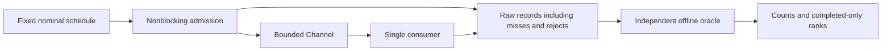

# Tail-Latency Evidence Bench

A small C#/.NET experiment that keeps the missing work visible. The generator follows a fixed open-loop schedule. A deliberately slow consumer fills a bounded channel; rejections and unfinished admissions remain in the result beside completed-only latency ranks.

Offline synthetic work only. No NIC, wire, exchange, cross-host latency, production HFT capacity or speed-improvement claim.


## Technology servicing preparation (2026-11-20)

Source pins prepare .NET 10 LTS SDK 10.0.404/runtime 10.0.15 for a prospective v0.1.0-preview.2. This preserves net10.0/C#14, BCL-only runtime dependencies, application code, accounting/loss/censoring semantics, raw records and all frozen M1 findings. A major .NET 11 migration has no required feature or support-lifetime benefit for this bounded change; the existing diagnostic tools remain pinned and are not rerun.

This is source preparation, not a new downloadable release. The published preview below remains v0.1.0-preview.1 with runtime 10.0.14. Native build/test/package/signature/download validation for the servicing binaries has not run. The observed local Windows 26H2 build 26300.10075 is absent from Microsoft's current .NET 10 supported-OS table. An existing supported Windows build route with project-specific controller/lease binding is required; another project's admission is not reusable. See [servicing decision and limits](docs/TECHNOLOGY-SERVICING.md). M1 is delivered and is not reopened.

## M1 recorded and accepted (2026-11-19)

The fixed six-case Windows/Linux record-cap experiment completed, plus one separately owner-authorized Windows cap99 supplement: seven native CLI calls total,24 distinct negative fixtures in both normal and optimized modes. Capacity99 is INCOMPLETE before start;100/101 account for100 records with matching offered schedules and null p99.9. The independent witness rejects every negative. The unchanged frozen oracle accepts N01–N08; those false positives are preserved as findings, not repaired behavior.

The original cap99 wrapper forced-cleanup HOLD is immutable. Its separately authorized supplement has valid strict data and natural original Job terminal. All owned scopes ended and released only their exact canonical leases. Archive suffixes were retained/resumed with exact206 responses; total archive-body bytes71,280,658 stayed within75MiB. No other healthy native case, metadata snapshot, signature or accepted archive was replayed. All CPU/memory/process/time/storage caps remained unchanged. No Actions, SDK rebuild, global trust/protection change or performance/security/production claim follows.

The [public M1 receipt](docs/evidence/m1-20261119/receipt.json) and [evidence guide](docs/evidence/m1-20261119/README.md) describe the scope and retained limitations. The existing v0.1.0-preview.1 runtime binaries/checksums/signatures remain unchanged; a separate synthetic-data ZIP, checksums and signature are published and freshly download-verified on that same preview. Execution harness commit416c4b32902a236eeba074a831d0a68490bcf2b6 is separate from the frozen runtime commit6158f7f8a9a8e4fd7c12ed575f427d7117b89801. Earlier HOLD/preparation entries below/above are historical.

## Architecture review

Read the [architecture case study](docs/ARCHITECTURE-CASE-STUDY.md) for the decision, rejected alternatives, failure examples, frozen-release evidence and short English/Persian introductions. Follow the [30-minute four-project review](https://github.com/pouriajamali/trading-execution-lab/blob/main/docs/FLAGSHIP-REVIEW.md) for a guided discussion. The [evidence index](docs/FLAGSHIP-EVIDENCE.json) separates runtime/tag CI from later documentation commits.

## Start with the decisions and their proofs

| Decision | Evidence |
| --- | --- |
| Do not hide overload by blocking the generator | Same nominal schedule/seed for healthy and slow cases; actual admissions/rejections recorded |
| Do not treat missing work as fast work | Generator misses, rejections and cutoff-censored admissions are separate counts |
| Do not invent a tail from a small sample | Exact raw-sample ranks; p99.9 suppressed below 100,000 completions |
| Do not silently lose measurement records | A requested run beyond the record cap returns INCOMPLETE before starting, without quantiles |
| Do not trust the producer's own statistics | Independent Python integer/Fraction oracle and eight corrupted-data counterexamples |

## Run the preview

Published preview: [`v0.1.0-preview.1`](https://github.com/pouriajamali/tail-latency-evidence-bench/releases/tag/v0.1.0-preview.1). Download **[Windows x64](https://github.com/pouriajamali/tail-latency-evidence-bench/releases/download/v0.1.0-preview.1/tail-latency-evidence-bench-v0.1.0-preview.1-win-x64.zip)**, **[Linux x64](https://github.com/pouriajamali/tail-latency-evidence-bench/releases/download/v0.1.0-preview.1/tail-latency-evidence-bench-v0.1.0-preview.1-linux-x64.tar.gz)** or [source](https://github.com/pouriajamali/tail-latency-evidence-bench/releases/download/v0.1.0-preview.1/tail-latency-evidence-bench-v0.1.0-preview.1-source.zip). Get the [checksums](https://github.com/pouriajamali/tail-latency-evidence-bench/releases/download/v0.1.0-preview.1/SHA256SUMS.txt), [checksum signature](https://github.com/pouriajamali/tail-latency-evidence-bench/releases/download/v0.1.0-preview.1/SHA256SUMS.txt.sig) and [public key](https://github.com/pouriajamali/tail-latency-evidence-bench/releases/download/v0.1.0-preview.1/SIGNING-PUBLIC-KEY.pub); verify downloaded bytes with [PROVENANCE.md](PROVENANCE.md) before executing them. Local builds and CI artifacts are separate from published releases.

From the extracted Windows x64 package:

```powershell
.\tail-evidence.exe --help
python tools/native_demo.py --cli tail-evidence.exe --out artifacts/demo
if ($LASTEXITCODE -ne 0) { throw 'Evidence validation failed' }
Get-Content artifacts/demo/receipt.json
Get-Content artifacts/demo/oracle.json
```

From the extracted native Linux x64 package:

```sh
./tail-evidence --help &&
python3 tools/native_demo.py --cli ./tail-evidence --out artifacts/demo &&
cat artifacts/demo/receipt.json
```

The self-contained CLI needs no SDK or online service. Python 3.12+ runs the independent verifier; OpenSSH verifies package provenance. Windows and Linux run their native CLI. Existing WSL can run the Linux package; its measurements are VM observations, never bare-metal or cross-platform speed evidence.

The demo runs three healthy/slow pairs, 5,000 planned requests each, a 100 microsecond period, channel capacity 64 and a fixed 20 millisecond drain. All cases use the same offered schedule, seed, cutoff/deadline settings and executable. The service loop's configured busy-wait target changes from 10 to 500 microseconds per work unit; this is a controlled overload fixture, not an optimized application. Sample values vary with OS load, scheduling, virtualization, clock and JIT. CI checks arithmetic/chronology/caps, without performance pass thresholds.

Use a new output directory for every attempt. Raw CSV, summary JSON and independent receipts are retained. COMPLETE means complete accounting; it does not mean every request was attempted, admitted or successful.

## Read the result before the percentile

```text
planned  = generatorMissed + attempted
attempted = admitted + rejected
admitted = completedAtCutoff + censoredAtCutoff
completedAtCutoff = success + failure
```

Generator lateness and deadline flags are orthogonal to those partitions. A completed synthetic failure still has a completion timestamp. Censored work has no observed completion by the fixed cutoff. An unvisited planned arrival at cutoff is a generator miss; no actual-send timestamp is invented.

Ranks use completed records only and keep their denominator beside them. Missing work can bias those ranks. p99.9's 100,000-completion display floor is a policy, not a confidence guarantee. See [measurement contract](docs/CONTRACT.md) and [observations and limitations](docs/OBSERVATIONS.md).

## Build and separate diagnostics

The prepared servicing source requires exact .NET SDK 10.0.404, runtime 10.0.15 and C#14. It is not a published or runtime-validated upgrade:

```sh
dotnet restore TailLatencyEvidence.slnx --locked-mode
dotnet build TailLatencyEvidence.slnx -c Release --no-restore -m:1
dotnet run --project tests/Evidence.Tests -c Release --no-build -- -result-xml artifacts/unit.xml
```

The runtime CLI uses BCL only. BenchmarkDotNet 0.15.8, xUnit v3 4.0.3 and dotnet-trace 10.0.750501 are pinned development/test tools, excluded from the shipped runtime graph. To repeat the isolated observer benchmark, run from `benchmarks/ObserverBench` and supply a NEW artifacts directory:

```sh
dotnet run -c Release -- ../../artifacts/observer
```

Its job explicitly uses `DontEnforcePowerPlan`. A successful process with zero executed benchmarks is rejected. This measures clock/read-and-store primitives separately; it is not the whole harness's observer cost and is not subtracted from end-to-end timings.



Optional developer tracing also requires the SDK: restore the local tool manifest, then collect only an explicitly launched lab child. Keep trace-on data separate from trace-off data:

```sh
dotnet tool restore
dotnet tool run dotnet-trace collect --buffersize 32 --profile dotnet-sampled-thread-time,dotnet-common --duration 00:00:05 --output artifacts/owned.nettrace -- ./tail-evidence run healthy artifacts/traced
```

Use the appropriate CLI path from the source/package working directory; do not attach the tool to unrelated processes. Traces stay private by default. A captured trace does not prove causality or a latency improvement.

See [decisions](docs/ADR.md), [runbook/review](docs/RUNBOOK.md), [notices](NOTICE.md) and [provenance](PROVENANCE.md). Original code: MIT; no private/shared project code, account/market connection or career-material change.

[CI resource policy](docs/CI-POLICY.md): documentation-only changes get real lightweight document/pipeline checks; source, tag and ordinary manual runs retain native validation. A separate, single-use M1 consumer profile is documented in that policy; admission and M1 completion require its actual receipts. Published runtime tags and release assets remain unchanged.

## Source readability

The current source expands compact C# layout for review. The published preview links identify its frozen runtime release. Formatting preserves complete syntax, token text and values, comments and directives; it does not introduce a runtime behavior or performance claim.

To reproduce a published package, use its exact original runtime source: [v0.1.0-preview.1 source](https://github.com/pouriajamali/tail-latency-evidence-bench/tree/6158f7f8a9a8e4fd7c12ed575f427d7117b89801) (`6158f7f8a9a8e4fd7c12ed575f427d7117b89801`). Later `main` layout is reviewed separately from those frozen release commits.

## Bounded M1 status

M1 remains HOLD; zero native M1 cases, archive downloads or SDK calls have run. Existing preview binaries/signatures, complete ESET proof and healthy controls are retained. The source keeps the platform/WMI removal, exact local canonical binding, finite provider queue correction and separate source-bound owned-SSH role; SSH dependencies are not imposed on Python module handles.

Libcrypto exact-file/native-catalog/current-offline-chain proof passed. The earlier owned SSH operation verified the public signature but did not establish trusted closure: six additional providers and a .rdata mismatch were recorded together. The approved consolidated continuation read only those six files. Native signatures succeeded for all six; current NoFlag offline chains passed for winrnr.dll, nlansp_c.dll, wshbth.dll and kernel.appcore.dll. The chains for napinsp.dll and DSPARSE.dll failed with NotTimeValid on the shared signer (expired 2024-11-14) and PCA2011 issuer (expired 2026-10-19).

The owner-authorized fresh 300-second timestamp supplement ran once on 2026-11-18, using only the two failed exact identities. Native signature/countersigner verification succeeded. Authenticated references were 2024-07-03T04:30:29.386Z for napinsp.dll and 2024-09-05T18:55:50.774Z for DSPARSE.dll; independent signer and timestamp chains passed at those times with NoFlag, Offline revocation, downloads disabled and existing roots. The original current-time False/NotTimeValid results remain unchanged.

Independent current-chain native revocation metadata exists with result zero and freshness 817 seconds for all five distinct nonroot certificates. The wrapper captured no CRL context or signed CRL/OCSP validity interval. Its conservative CRL-context path therefore stopped with PRESENT_TIME_NONREVOCATION_NOT_PROVEN; it has not validated an OCSP alternative. This is an evidence-capture limitation, not evidence that the cache lacks valid data, that a certificate is revoked, or that its signature is bad. Timestamp/historical validity alone does not complete the agreed current-revocation proof.

The gate prevented the changed SSH admission again: zero new SSH invocations, module observations, image reads or native M1 cases. The helper exited naturally in its inherited capped Job and the canonical lease was released after all owned terminal evidence. The one execution is consumed; neither the earlier window nor the new window is reset or extended. No runtime retry, cache/store/clock/trust/security change or healthy proof replay follows this hold.

The five-certificate follow-up first encountered canonical-lane contention without a target start. Following the owner's explicit handoff approval, the execution clock was moved to immediately after a successful atomic claim. One real capped run then exposed a wrapper flag bug: decimal6 combined cache-only and wire-only and was rejected with 0x80070057. That result is not a cache miss. The direct owner then requested retry; the corrected flags are cache-only0x2 | dont-cache0x8 = 0xA. Both actual claim-time windows and the earlier expired windows are retained separately.

The corrected retry read public certificate metadata from the exact prior catalog and looked up three unique CDP URLs already inside the five pinned certificates. All three cache-only lookups returned ERROR_FILE_NOT_FOUND(2); zero CRL/OCSP artifacts were obtained. This applies only to those exact URLs in that API/user context, not every machine cache or OCSP source. Current signed revocation evidence therefore remains UNKNOWN/HOLD. The first malformed-call result, successful timestamp proofs and current-time chain failures are retained separately. At that cache-only stage, the artifact-verification and changed SSH/mapping branches had not executed. Both actual owned runs ended naturally and released only their own canonical leases. Execution received its one end-of-turn/release notice. No follow-up was performed under that cache-only authority; the separately authorized three-GET result follows.

The owner then authorized exactly three literal-CDP GETs. Each returned HTTP200 once, without redirect, URL normalization or retry: 518/824/814 bytes, 2,156 bytes total in an 8.25-second network role. Independent signature/issuer-key/scope/current interval/serial checks accepted four of the five certificate revocation proofs. The Windows signer's 518-byte CRL has thisUpdate=2026-10-15T18:53:54Z and no nextUpdate: the following ASN.1 field is the extension block. The strict profile therefore cannot establish now<nextUpdate. Its signature/scope/serial checks were not reached; no revoked/bad-signature or indefinite-validity conclusion is invented. HTTP success does not admit this artifact.

All owned download/root processes terminated naturally and the exact own lease was released; Execution received one end-of-turn notice for this turn. The changed SSH, image observation and both RIDs' M1 cases remain unexecuted. Four positive revocation proofs and all earlier healthy evidence are retained for reuse. The remaining input is an identity-bound current revocation proof with an authenticated usable validity bound for the single Windows signer. No retry, new endpoint, URL change, synthetic expiry, time-check exception or trust/security change is authorized as an automatic follow-up.

The [owned-SSH role profile](tools/m1/metadata/owned-ssh-profile.json) stays HOLD. The consolidated tool's file-proof prefix ran; its SSH/mapping/CFG branch is source preparation only and is not runtime-validated or admitted. All unresolved mapping claims remain pending, including libcrypto .rdata. Existing three role-guard checks and healthy ESET/control evidence are reused.

GitHub Actions is prohibited. CI was not run per owner instruction. Signed task-branch pushes use [skip ci] after checking actual triggers; no tag, PR, merge, release, protection or truststore change is made. Source/evidence delivery is separate from complete M1 delivery; original Windows/Linux fixed cases are pending.

## Linux signature-role preparation and explicit retry (2026-11-18)

M1 is HOLD. Linux metadata completed in3.635628s with20,530,028 bytes read, under actual UID/GID1000 Ubuntu24.04.5, CPU200%, memory512MiB, swap0 and tasks64. Six observed ELF files matched exact root-owned nonwritable installed-package MD5 records. This is installed-vendor identity metadata, not publisher authentication or signature-role admission. The receipt explicitly says METADATA_COMPLETE_NOT_ADMISSION, admitted=false and fullClosureQualified=false. No Linux SSH signature, archive transfer, SDK call or native M1 case ran.

The existing Windows SSH profile remains HOLD: one signer CRL has no mandatory nextUpdate, and the separate mapped-image issues remain unresolved. The four accepted CRL proofs, ESET/libcrypto proofs and healthy controls are retained without replay. Source audit also found that Windows Python qualification still unconditionally requires the Windows SSH role. It cannot safely consume a Linux result until an actual Linux signature role is admitted and a separately labeled, identity-bound handoff is implemented. No Windows role or host admission is transferred.

Three source-bound helpers implement only the bounded Linux metadata producer: fixed Windows canonical owner, private direct-cgroup launcher and nonroot observer. Each actual phase records its own finite300s post-claim window and cause, retaining work270/terminal30/role20/qualification60, read64MiB, file256, proof256KiB/all-role1MiB and scratch1GiB. Existing controllers are required; no global controller enablement, trust, clock, certificate-store or protection change occurs. Actual stopped-child membership precedes resume; every actual worker waited to terminal, private cgroup was empty/removed and only exact-own lease was released. Original output directories refuse replay.

One human-retry claim stopped BUSY against04. After verified04 terminal/release, one event-driven claim stopped BUSY against02. After verified02 terminal/release, the first actual metadata phase stopped ROOT_OWNED_NONWRITABLE_VENDOR; its generic original result is preserved without assigning an unobserved failing path. Source independently rejected legitimate empty Python package markers; the correction permits zero bytes only for root-owned nonwritable .py files and retains nonempty ELF validation. The next receipt recorded the empty /usr/lib/python3.12/urllib/__init__.py and advanced to a dpkg-query -S command timeout. The causal fix replaced the global owner search with only the six exact observed vendor/package MD5 records; metadata then completed under the unchanged role20 ceiling. Failure logging now retains exact predicate/path/identity and bounded command diagnostics. Previous failures and all actual windows remain separate, never reset or relabeled.

The21-entry active manifest retains frozen verifier, oracle, witness, case plan, Windows controllers and Windows profile unchanged; historical helper files/evidence remain in Git. The successful metadata is reused, not rerun. Remaining requirements are actual Linux owned-SSH mapping/read-only-load/import-slot/held-file terminal qualification, the same known-key native manifest signature, explicit producer/consumer signature handoff plus each consumer archive digest, and the unchanged six native cases/24 negative fixtures. The current existing Linux observer has no admitted ELF image/import-slot witness; package hashes or a successful SSH exit cannot substitute. At the metadata checkpoint, these helpers did not implement or qualify that witness; the dated owned-SSH continuation below supersedes that source-preparation state. No new framework/runner is admitted. No image/module snapshot was taken in this metadata work.

Immutable private results are in outputs/wave4-m1-record-cap-20261116/linux-role-metadata-after02-release-20261118, linux-role-metadata-empty-marker-fix-20261118 and linux-role-metadata-exact-package-fix-20261118. The last metadata SHA256 is8b1d6345f7ae58a9357aa194ced570458c76e799d056fe8e034daa3c0f2b9bef; terminal SHA25660522f832983d19e405559484c77e40344f91d4f3bcdf521551c95ac11f1fb26. All are private, data-only evidence. Source checks cover AST, exact manifest binding and whitespace; runtime evidence covers metadata only. CI was not run per owner instruction. Signed [skip ci] task-branch delivery is separate from M1 completion; original preview binaries/signatures/releases are unchanged and no duplicate release is created.

## Actual Linux owned-SSH witness: current HOLD (2026-11-18)

The22-source manifest now includes a fixed owned-SSH ELF witness. It uses existing native OpenSSH crypto and native loader/kernel APIs only. Successful metadata is reused. The six exact file providers stay fixed: no additional file provider, global trust/configuration/protection change, custom signature crypto, framework, runner or SDK is introduced. Actual child UID/cgroup/birth and original wait, held provider bytes, DT_NEEDED/native bindings, actual mapping identities, relocation/import slots and all read-only PT_LOAD portions remain mandatory. Unknowns remain HOLD. Negative manifest/signature branches are prepared but have not run.

Seven finite, causally recorded owned-SSH prefix phases were attempted, each under the original caps and a distinct post-claim300s window; no accepted signature, manifest stdin, archive transfer or native M1 case resulted. The retained first log identified nine kernel-vDSO self bindings previously misclassified as files. Source now checks the actual AT_SYSINFO_EHDR, exact child/parent kernel-vDSO bytes and five exact LINUX_2.6 symbol definitions; native IFUNC results must equal a verified file-provider or exact kernel-symbol RVA. Dynamic pointer/DT_DEBUG/RELR handling verifies exact glibc ABI values and actual r_debug/link_map instead of masking bytes. IRELATIVE uses the existing native resolver after executable-byte verification; an observed native NULL is checked as an exact zero slot, not an unknown provider exemption. Native TLS or any unsupported/unknown relocation remains a hard HOLD, and complete admission is not claimed.

The current actual failure is READONLY_ELF_IMAGE_MISMATCH in /usr/lib/x86_64-linux-gnu/ld-linux-x86-64.so.2 at RVA222112. The frozen file has eight zero bytes; recorded runtime bytes are80ec716e417a0000. The cause is UNKNOWN; no tampering, benign-loader-field, CFG or full-image-pass claim follows. Earlier Windows and Linux failures remain unchanged. Every owned role worker/SSH process reached actual terminal, its private cgroup was empty/removed and its exact own canonical lease was released. The stopped SSH child was killed only on its failed witness; the root cleanup was natural. No role admission or trusted crypto result was manufactured.

A separate read of only the pinned236,616-byte loader file for static-symbol analysis timed out in the WSL.exe transport after15s. The Windows tool session exited1; the guest data-reader PID/terminal was not captured and is UNKNOWN. No new guest-heavy work follows that uncertainty. A single necessary request to05 asks for retained exact file bytes or one existing responsive read-only route, max256KiB/15s, with no recovery/reset, global scan, new qualification or test. Pending input does not authorize bypassing the mismatch. Private consolidated record: outputs/wave4-m1-record-cap-20261116/LINUX-SSH-EXACT-READONLY-HOLD-20261118.json. Metadata-only completion is separate from signature-role admission; M1 remains HOLD, no new runtime release or Actions run is justified.

Native semantics were checked against the upstream glibc source for [dynamic fields](https://codebrowser.dev/glibc/glibc/elf/get-dynamic-info.h.html), [AMD64 relocation](https://codebrowser.dev/glibc/glibc/sysdeps/x86_64/dl-machine.h.html), and the kernel project's [owned-process memory access](https://man7.org/linux/man-pages/man5/proc_pid_mem.5.html). These references justify typed rules; they do not prove this host's failed image or grant access.

The exact05 input request completed without file bytes: its independently hashed host receipt observed Ubuntu-24.04=Stopped at1795021013.569569, with no guest start/recovery. That later stopped-distro observation resolves the prior active-namespace uncertainty at that observation only; it does not manufacture an original guest-PID wait. A23rd fixed helper now prepares only one236,616-byte loader-data transfer through the existing capped direct-file launcher, reusing the same source/lease/cgroup controls. Ordinary use of the existing Ubuntu installation is distinct from reset/recovery or a replacement runner. Its one atomic claim returned BUSY against04/PID34008/birthFILETIME:134394946521013625 before any guest/target/window. No direct-file data transfer has run. One necessary exact-input/release-event request to04 is pending; there is no claim or status loop. The current consumer-binding source additionally holds/checks only the already declared Python vendor file set through owned terminal; it has not been runtime-validated. The loader RVA222112 remains UNKNOWN/HOLD, and no successful metadata or crypto test is replayed.

## Bounded official loader-data retry: HOLD (2026-11-18)

This update supersedes the earlier static-input preparation status. The exact loader was obtained once as data only (236,616 bytes, SHA256 c20a2dc8917c755f02b94049356320fe1f62ac7d9f8994731f807d9df39302da). Static ELF analysis places RVA222112 in .data.rel.ro, without a covering public symbol or DT_PLTGOT; the runtime difference remains UNKNOWN. No exception or accepted ABI value was added. Successful metadata and seven owned-SSH prefix results were reused without replay.

The official Ubuntu .symtab section request returned HTTP404. The full-debug Linux route first stopped before any child on unavailable existing cgroup controllers; a later transport had unknown request completion and was closed using exact owned-namespace terminal evidence. A Windows data-only launcher reused the existing 512MiB/16-process/CPU1000/affinity3 Job. Its Frame parameter-name collision was fixed causally; the subsequent exact retained-file read timed out at20s before any HTTP intent. That UNC read was not replayed. After one BUSY claim and verified previous-owner terminal, one replacement full-debug GET (1MiB/5s, ordinary verified TLS, no redirects) ended with TimeoutError. The child ended naturally, Job active population was0, and only the exact own canonical lease was released. No complete debug artifact was accepted. Prior unknown request state remains UNKNOWN.

The missing input is the matching debug file 77dbd4379bf0b5af3e05be7fb6af1e4cea7c96.debug, GNU build-ID0d77dbd4379bf0b5af3e05be7fb6af1e4cea7c96/debuglink CRC32 7273804a, through an already authorized responsive route. Its existing bound is one data artifact, <=1MiB/5s, role20s and a300s window only after atomic canonical claim. No unchanged retry is scheduled. This input would enable static causal analysis; it would not itself admit the Linux role or the host. The separate Windows signer still lacks an authenticated usable CRL nextUpdate. No trust, security protection, global controllers or system settings were changed.

Only source preparation is delivered. Finite fractional claim timestamps are now preserved consistently by the Python/PowerShell ticket gates, with unchanged300/270/30 ceilings. Unwired signature-handoff prototypes were retained privately and removed from the active source graph. M1 remains HOLD: six native cases and24 negative fixtures are pending, with zero native M1/SDK calls in this continuation. No Actions, healthy-test replay, binary rebuild, duplicate release, or new runtime admission occurred. Existing preview v0.1.0-preview.1 assets/signatures remain unchanged. Detailed private evidence: outputs/wave4-m1-record-cap-20261116/OFFICIAL-DEBUG-RETRY-FINAL-20261118.json.

## One overall-deadline delta: HTTP404 (2026-11-18)

Under fresh explicit owner authority relayed by the coordinator, only the single official full-debug GET's overall deadline changed from5s to15s. The network role remained20s and the post-atomic-claim whole/work/terminal limits remained300/270/30s. The exact request, buildID/CRC/loader identity and unchanged1MiB/one-artifact limit are bound into source, manifest, frame, Job profile and receipts. A single hard overall timer limits the entire request; socket/chunk timeouts do not extend it. CPU/memory/process/storage/trust/security and all other roles remain unchanged.

The one new canonical run received HTTP404 from exactly https://debuginfod.ubuntu.com/buildid/0d77dbd4379bf0b5af3e05be7fb6af1e4cea7c96/debuginfo. Its Content-Length header was9; the non200 body was not read, no debug artifact was accepted, and ELF/buildID/CRC validation was not reached. This supersedes the earlier5s-timeout availability result for this single URL, without claiming file absence elsewhere or resolving older retained-request UNKNOWNs. The unchanged capped Job child ended naturally with originalWait0/active0; the exact own canonical lease was released. No further timeout, URL or cap changes or unchanged retries follow.

M1 remains HOLD: loader RVA222112 is still UNKNOWN, the Windows signer's authenticated nextUpdate requirement is unchanged, and six native cases/24 negative fixtures remain pending. Required new input is the exact matching retained debug file or equivalent exact symbol evidence through an explicitly supplied permitted route; HTTP200 or symbol bytes alone would not establish the cause or admit a role. Source-only validation checks the changed files and bindings; no native/SDK/healthy tests, Actions, host admission, binary rebuild or duplicate release occurred. Existing preview assets/signatures are retained. Private final evidence: outputs/wave4-m1-record-cap-20261116/OFFICIAL-DEBUG-15S-FINAL-20261118.json.


## Current M1 continuation (2026-11-19)

The independent Linux manifest-signature role is now qualified. The exact official Ubuntu debug file matches the retained loader build ID and debuglink CRC. Debug-typed native initializer, TLS, dependency-scope and kernel-input checks preserve complete read-only ELF byte comparisons: six held file providers, 19,437 relocations, 771 import slots and 8,841,896 read-only bytes. Unknown fields and providers remain HOLD; no byte mask, trust/protection/global-controller change or additional file provider was introduced.

The completed positive native OpenSSH result and altered-manifest rejection were retained with their original scope/handle receipts. Only the unfinished malformed-signature negative was completed in a separate canonical window: actual exit255, early stdin rejection, original wait, natural terminal and removed cgroup. The final role used1.958222s and52,397,096 conservatively counted bytes under unchanged ceilings; both scopes are identity-bound and the old HOLD receipt is not relabelled. Healthy native controls were not replayed during that completion.

The32-file consumer manifest now accepts only this pinned manifest-signature data fact together with each consumer's own exact archive digest and existing safe-extraction rules. Windows OpenSSH remains HOLD because its signer CRL has no nextUpdate. Linux signature evidence does not admit Windows SSH or transfer host admission; Python/PE/ESET/kernel gates remain independent. New source checks validate retained proof bindings and four rejection controls without archive/native/SDK calls. Fractional canonical deadlines are retained; the Linux shell conservatively floors only its remaining runtime, never extends the original deadline.

M1 is still pending its six fixed Windows/Linux cases and24 negative fixtures. Source preparation and signature-role success are not M1 runtime completion. No Actions ran, no existing healthy regression group was replayed, and no preview binary/signature was replaced or duplicated. Existing preview v0.1.0-preview.1 remains the downloadable runtime. Private final role: outputs/wave4-m1-record-cap-20261116/linux-owned-ssh-negative-kernel-reference-fix-once-20261119/FINAL.json. The following earlier HOLD entries are historical.


2026-11-19 consumer outcome: both Windows import qualifiers completed with unresolved=[] and current ESET held-file/mapping checks; the held probe and wrong-plan denial passed. No native M1 case ran. The archive transfer stopped at its unchanged45-second deadline after26,411,008 bytes. The prefix is retained with SHA256 afa3d2d22e7d1b378b7daac4a236ceaa6a1c4550a5f8e7289ccb0741e7835a8e. A fixed suffix-only Range route is prepared: one request, exact206/Content-Range/remaining Content-Length, no full-body fallback, unchanged45s/75MiB/whole-window ceilings and final frozen full-file SHA. Completed qualifier/control data are reused; each new consuming child still checks its own actual Job/profile, current held ESET mapping and consuming-module file identities. No global host admission is transferred and no healthy qualification/control test or snapshot is replayed. Earlier role/input/runtime statuses remain unchanged; M1 is pending.


2026-11-19 retained-archive/case update: the suffix-only request returned exact206 and9,460,265 remaining bytes; the complete35,871,273-byte Windows archive matches frozen SHA256 e5374e478cd5416707ba3dc009e9aa20cb4fdc912adba0d9c8f8ae944d2b9958. Native manifest data conjunction and safe extraction completed. Windows cap99 executed once: actual exit4, RAW_RECORD_CAP_BEFORE_START, header-only raw and expected configuration. Its Python worker exited0 with original wait0, but the first Job active count was nonzero; the controller forced residual cleanup and recorded active0. That wrapper HOLD is retained. The residual process identity/cause is UNKNOWN, and neither natural completion nor full M1 acceptance is inferred.

The next bounded controller associates its own Job completion port before resume and waits on notifications while checking actual Job population, within the existing60s phase/whole deadline. Caps, noBreakaway and kill-on-close remain unchanged. Process hints in notifications are not PID identities. No old case, accepted archive, qualifier, signature or snapshot is replayed; the other five reserved native cases and24 fixtures remain eligible. The original cap99 wrapper HOLD remains an explicit final acceptance gate even if the remaining data completes. Source delivery is distinct from completion; GitHub Actions remain forbidden.


2026-11-19 final-input continuation: Windows cap99/100/101 datasets and12 distinct negative fixtures completed normal/optimized validators. The old cap99 wrapper forced-cleanup HOLD remains immutable. A later validator exercised the corrected owned-Job wait: first active1, a scoped completion-port notification and actual active0, natural original worker terminal, with unchanged ceilings. The owner explicitly authorized one separate cap99 supplement, maximum one additional native call under the same caps/canonical300s window. The original frozen six-case plan and case99 attempt are not rewritten.

Linux vendor observer/control/declared-input proofs completed and are reused as data with fresh actual child cgroup and consuming-file checks. Its initial archive body stopped at45.069s after23,658,496 bytes; prefix SHA256 fdb1c54f51f6c582f8fefc1ddb93626d1b8862836b1fa690f59fad9b60f277f2. One exact206 suffix of11,750,889 bytes remains, followed only by the three pending Linux cases and fixtures. No healthy metadata snapshot, probe, Windows case/fixture, signature or accepted full archive is replayed. Six new source controls reject changed proof bytes, live scope, absent original wait, unknown control and broadened host/closure admission. An expected first rejection exposed a source-check wrapper exception-type error; it was corrected without any native/window start or repeating that successful control. M1 is still pending actual supplement/Linux results; Actions, SDK rebuild, trust/protection changes and performance claims remain absent.
