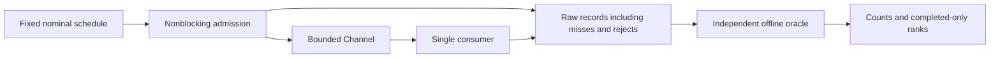

# Tail-Latency Evidence Bench

A small C#/.NET experiment that keeps the missing work visible. The generator follows a fixed open-loop schedule. A deliberately slow consumer fills a bounded channel; rejections and unfinished admissions remain in the result beside completed-only latency ranks.

Offline synthetic work only. No NIC, wire, exchange, cross-host latency, production HFT capacity or speed-improvement claim.

## Current servicing preview - 2026-11-20

[v0.1.0-preview.2](https://github.com/pouriajamali/tail-latency-evidence-bench/releases/tag/v0.1.0-preview.2) delivers .NET10 LTS SDK10.0.404/runtime10.0.15 with net10.0/C#14 and unchanged offline measurement/accounting semantics. Native Windows/Linux packages, source, SHA256 checksums and the known-key signature are published and actually download-verified. Windows unit tests: 15 total/0 failed; Linux: 15 total/0 failed. Native package checks and six new source/owner/byte rejection controls passed independently; M1 and benchmarks were not replayed.

Signed release source: [18e1d4a33e69](https://github.com/pouriajamali/tail-latency-evidence-bench/commit/18e1d4a33e694f20fbcb20781e69fbefb663d426). Native archive source commits: Windows `80f431f0bfde6032f97ac27b9fe56943cf3a52d4`, Linux `18e1d4a33e694f20fbcb20781e69fbefb663d426`; product/build/package inputs match, with Linux controller accounting/path fixes between them. Native Linux publish output was assembled as data on Windows without another SDK call and checked natively on Linux. [Servicing receipt](https://github.com/pouriajamali/tail-latency-evidence-bench/blob/d8334e1960a3e8ee583d728441b66f3c117148f4/docs/evidence/servicing-20261120/receipt.json). The default branch retains the original source baseline; use the signed servicing tag for the current SDK/runtime source. Windows26H2 is observed experimental with formal vendor support NOT_CONFIRMED. Linux runtime package signature data was verified by the native Windows verifier; the native Linux verifier's20s timeout remains recorded. No Actions, trust/protection change, global host/provider security, speed or production claim follows.

The original [v0.1.0-preview.1 and M1 evidence](https://github.com/pouriajamali/tail-latency-evidence-bench/releases/tag/v0.1.0-preview.1) remain immutable, including the frozen oracle's known false positives. This limitation also remains in the standalone oracle shipped in the current preview; the independent M1 witness rejects those inputs. [Exact caller/source/fixture scope](https://github.com/pouriajamali/tail-latency-evidence-bench/blob/d2b42cb323717843d3e6facfe689fe87cd1654e4/docs/ORACLE-SCOPE.md).

This source revision fixes standalone preflight validation for N01–N08. The
oracle requires a valid declared configuration, actual exceedance of the
declared raw cap, zero cutoff and warmup, an empty offered-schedule digest,
header-only CSV and null statistics. The verdict describes consistency of
those files. M1's separate witness checks the recorded invocation as well.
Run the offline regressions with
`python -m unittest discover -s tools -p test_oracle.py`.

## Architecture review

Read the [architecture case study](docs/ARCHITECTURE-CASE-STUDY.md) for the decision, rejected alternatives, failure examples, frozen-release evidence and short English/Persian introductions. Follow the [30-minute four-project review](https://github.com/pouriajamali/trading-execution-lab/blob/main/docs/FLAGSHIP-REVIEW.md) for a guided discussion. The [evidence index](docs/FLAGSHIP-EVIDENCE.json) separates runtime/tag CI from later documentation commits.

## Start with the decisions and their proofs

| Decision | Evidence |
| --- | --- |
| Do not hide overload by blocking the generator | Same nominal schedule/seed for healthy and slow cases; actual admissions/rejections recorded |
| Do not treat missing work as fast work | Generator misses, rejections and cutoff-censored admissions are separate counts |
| Do not invent a tail from a small sample | Exact raw-sample ranks; p99.9 suppressed below 100,000 completions |
| Do not silently lose measurement records | A requested run beyond the record cap returns INCOMPLETE before starting, without quantiles |
| Do not trust the producer's own statistics | Independent Python integer/Fraction oracle and eight corrupted-data counterexamples |

## Run the preview

Published preview: [`v0.1.0-preview.2`](https://github.com/pouriajamali/tail-latency-evidence-bench/releases/tag/v0.1.0-preview.2). Download **[Windows x64](https://github.com/pouriajamali/tail-latency-evidence-bench/releases/download/v0.1.0-preview.2/tail-latency-evidence-bench-v0.1.0-preview.2-win-x64.zip)**, **[Linux x64](https://github.com/pouriajamali/tail-latency-evidence-bench/releases/download/v0.1.0-preview.2/tail-latency-evidence-bench-v0.1.0-preview.2-linux-x64.tar.gz)** or [source](https://github.com/pouriajamali/tail-latency-evidence-bench/releases/download/v0.1.0-preview.2/tail-latency-evidence-bench-v0.1.0-preview.2-source.zip). Get the [checksums](https://github.com/pouriajamali/tail-latency-evidence-bench/releases/download/v0.1.0-preview.2/SHA256SUMS.txt), [checksum signature](https://github.com/pouriajamali/tail-latency-evidence-bench/releases/download/v0.1.0-preview.2/SHA256SUMS.txt.sig) and [public key](https://github.com/pouriajamali/tail-latency-evidence-bench/releases/download/v0.1.0-preview.2/SIGNING-PUBLIC-KEY.pub); verify downloaded bytes with [PROVENANCE.md](PROVENANCE.md) before executing them. Local builds and CI artifacts are separate from published releases.

From the extracted Windows x64 package:

```powershell
.\tail-evidence.exe --help
python tools/native_demo.py --cli tail-evidence.exe --out artifacts/demo
if ($LASTEXITCODE -ne 0) { throw 'Evidence validation failed' }
Get-Content artifacts/demo/receipt.json
Get-Content artifacts/demo/oracle.json
```

From the extracted native Linux x64 package:

```sh
./tail-evidence --help &&
python3 tools/native_demo.py --cli ./tail-evidence --out artifacts/demo &&
cat artifacts/demo/receipt.json
```

The self-contained CLI needs no SDK or online service. Python 3.12+ runs the independent verifier; OpenSSH verifies package provenance. Windows and Linux run their native CLI. Existing WSL can run the Linux package; its measurements are VM observations, never bare-metal or cross-platform speed evidence.

The demo runs three healthy/slow pairs, 5,000 planned requests each, a 100 microsecond period, channel capacity 64 and a fixed 20 millisecond drain. All cases use the same offered schedule, seed, cutoff/deadline settings and executable. The service loop's configured busy-wait target changes from 10 to 500 microseconds per work unit; this is a controlled overload fixture, not an optimized application. Sample values vary with OS load, scheduling, virtualization, clock and JIT. CI checks arithmetic/chronology/caps, without performance pass thresholds.

Use a new output directory for every attempt. Raw CSV, summary JSON and independent receipts are retained. COMPLETE means complete accounting; it does not mean every request was attempted, admitted or successful.

## Read the result before the percentile

```text
planned  = generatorMissed + attempted
attempted = admitted + rejected
admitted = completedAtCutoff + censoredAtCutoff
completedAtCutoff = success + failure
```

Generator lateness and deadline flags are orthogonal to those partitions. A completed synthetic failure still has a completion timestamp. Censored work has no observed completion by the fixed cutoff. An unvisited planned arrival at cutoff is a generator miss; no actual-send timestamp is invented.

Ranks use completed records only and keep their denominator beside them. Missing work can bias those ranks. p99.9's 100,000-completion display floor is a policy, not a confidence guarantee. See [measurement contract](docs/CONTRACT.md) and [observations and limitations](docs/OBSERVATIONS.md).

## Build and separate diagnostics

The signed servicing tag requires exact .NET SDK 10.0.404, runtime 10.0.15 and C#14. Check out that tag before building:

```sh
git fetch origin tag v0.1.0-preview.2
git switch --detach v0.1.0-preview.2
dotnet restore TailLatencyEvidence.slnx --locked-mode
dotnet build TailLatencyEvidence.slnx -c Release --no-restore -m:1
dotnet run --project tests/Evidence.Tests -c Release --no-build -- -result-xml artifacts/unit.xml
```

The runtime CLI uses BCL only. BenchmarkDotNet 0.15.8, xUnit v3 4.0.3 and dotnet-trace 10.0.750501 are pinned development/test tools, excluded from the shipped runtime graph. To repeat the isolated observer benchmark, run from `benchmarks/ObserverBench` and supply a NEW artifacts directory:

```sh
dotnet run -c Release -- ../../artifacts/observer
```

Its job explicitly uses `DontEnforcePowerPlan`. A successful process with zero executed benchmarks is rejected. This measures clock/read-and-store primitives separately; it is not the whole harness's observer cost and is not subtracted from end-to-end timings.



Optional developer tracing also requires the SDK: restore the local tool manifest, then collect only an explicitly launched lab child. Keep trace-on data separate from trace-off data:

```sh
dotnet tool restore
dotnet tool run dotnet-trace collect --buffersize 32 --profile dotnet-sampled-thread-time,dotnet-common --duration 00:00:05 --output artifacts/owned.nettrace -- ./tail-evidence run healthy artifacts/traced
```

Use the appropriate CLI path from the source/package working directory; do not attach the tool to unrelated processes. Traces stay private by default. A captured trace does not prove causality or a latency improvement.

See [decisions](docs/ADR.md), [runbook/review](docs/RUNBOOK.md), [notices](NOTICE.md) and [provenance](PROVENANCE.md). Original code: MIT; no private/shared project code, account/market connection or career-material change.

[CI resource policy](docs/CI-POLICY.md): documentation-only changes get real lightweight document/pipeline checks; source, tag and manual runs retain native validation. Published runtime tags and release assets remain unchanged.

## Source readability

The current source expands compact C# layout for review. The published preview links identify its frozen runtime release. Formatting preserves complete syntax, token text and values, comments and directives; it does not introduce a runtime behavior or performance claim.

To reproduce a published package, use its exact original runtime source: [v0.1.0-preview.1 source](https://github.com/pouriajamali/tail-latency-evidence-bench/tree/6158f7f8a9a8e4fd7c12ed575f427d7117b89801) (`6158f7f8a9a8e4fd7c12ed575f427d7117b89801`). Later `main` layout is reviewed separately from those frozen release commits.
