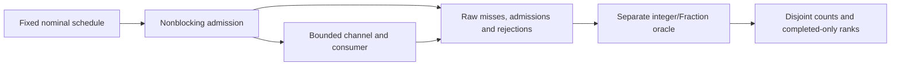

# Tail-Latency Evidence Bench: architecture case study

Documentation edition: 10 November 2026. Original synthetic/local work prepared with AI assistance for Pouria Jamali. This is a selected architecture-and-evidence review, not an exhaustive code or security audit.

Runtime: [`v0.1.0-preview.1`](https://github.com/pouriajamali/tail-latency-evidence-bench/releases/tag/v0.1.0-preview.1) at `6158f7f8a9a8e4fd7c12ed575f427d7117b89801`. The later documentation branch does not replace that runtime identity.

[Machine-readable evidence](FLAGSHIP-EVIDENCE.json) · [30-minute four-project review](https://github.com/pouriajamali/trading-execution-lab/blob/main/docs/FLAGSHIP-REVIEW.md) · [Installation](../README.md)

## Problem: completed-only latency can hide missing work

An overloaded system can reject or fail to finish much of an offered workload. Reporting only the completed requests' percentile leaves those missing requests outside its denominator. The engineering question here is whether the accounting and interpretation survive overload, not whether a particular C# implementation is faster.

The generator follows a fixed nominal open-loop schedule. Admission does not block to make the consumer's capacity look like the offered rate. A bounded channel can refuse work, and a fixed drain cutoff can leave admitted work unfinished. Both outcomes remain visible.

## Architectural decision: retain the denominator before reporting ranks

```text
planned = generatorMissed + attempted
attempted = admitted + rejected
admitted = completedAtCutoff + censoredAtCutoff
completedAtCutoff = success + failure
```

Generator lateness and deadline flags are separate from these terminal partitions. An unvisited arrival at cutoff is not assigned an invented send timestamp. A completed synthetic failure still has a completion timestamp; censored work has no observed completion by cutoff.

The C# implementation writes bounded raw records. A separate Python integer/Fraction oracle reconstructs counts, chronology, offered schedule and exact sample ranks. Completed-only ranks retain their denominator and are not relabeled as the latency of all planned requests. A request exceeding the raw-record cap is `INCOMPLETE` before starting and has no statistics. p99.9 is suppressed below 100,000 completions; that display floor is a policy, not a statistical confidence guarantee.



## Alternatives excluded by this contract

| Alternative | What it would obscure | Chosen cost / boundary |
| --- | --- | --- |
| Block the generator until the consumer accepts | Offered work becomes coupled to consumer progress | Explicit misses, rejections and scheduling lateness remain in the output |
| Drop unfinished rows before producing a percentile | Missing work disappears from the denominator | Censoring stays visible beside completed-only ranks |
| Display p99.9 from a 5,000-request case | A small tail sample is presented with unjustified precision | The display is suppressed; a larger sample still would not prove confidence by itself |
| Trust the implementation's own summary | An accounting bug can confirm itself | Separate oracle reconstruction and eight corrupted-output controls |
| Subtract an isolated timestamp/store cost from end-to-end results | Primitive overhead is not the complete observer effect | Diagnostics and observed latency remain separate datasets |

These are measurement-policy choices, not competing queue or runtime benchmarks. See the frozen [contract](https://github.com/pouriajamali/tail-latency-evidence-bench/blob/6158f7f8a9a8e4fd7c12ed575f427d7117b89801/docs/CONTRACT.md), [`Runner.cs`](https://github.com/pouriajamali/tail-latency-evidence-bench/blob/6158f7f8a9a8e4fd7c12ed575f427d7117b89801/src/Evidence/Runner.cs), [`Model.cs`](https://github.com/pouriajamali/tail-latency-evidence-bench/blob/6158f7f8a9a8e4fd7c12ed575f427d7117b89801/src/Evidence/Model.cs) and [oracle](https://github.com/pouriajamali/tail-latency-evidence-bench/blob/6158f7f8a9a8e4fd7c12ed575f427d7117b89801/tools/oracle.py).

## Counterexamples and named executable evidence

| Counterexample / failure | Expected result | Frozen evidence |
| --- | --- | --- |
| Eight hand-worked requests include unsent, rejected and unfinished work | Disjoint counts reconstruct the original workload | [`EightHandWorkedRequestsHaveDisjointAccounting`](https://github.com/pouriajamali/tail-latency-evidence-bench/blob/6158f7f8a9a8e4fd7c12ed575f427d7117b89801/tests/Evidence.Tests/AnalysisTests.cs) |
| No completed samples or insufficient tail sample | No invented zero latency or p99.9 | `NoSamplesNeverMeansZeroLatency` and `P999DisplayFloorIsNotAConfidenceClaim` in the same tests |
| Raw record capacity is too small | Incomplete before start, with no records/statistics passed off as a completed run | `PreflightRecordCapIsIncompleteWithoutQuantilesOrLostSamples` |
| A row has impossible chronology or completes after cutoff | Reject the invalid observation | `ImpossibleChronologyIsRejected`, `CompletedAfterCutoffIsRejected` |
| Deliberately corrupt raw/summary data | Independent verification fails | Eight cases in [`tools/test_oracle.py`](https://github.com/pouriajamali/tail-latency-evidence-bench/blob/6158f7f8a9a8e4fd7c12ed575f427d7117b89801/tools/test_oracle.py) |

The historical diagnostic work also retained a BenchmarkDotNet attempt that executed zero benchmarks because its working directory was wrong. A later launcher checks for actual statistical reports. A successful process exit alone was not accepted as measurement evidence. The [observations note](https://github.com/pouriajamali/tail-latency-evidence-bench/blob/6158f7f8a9a8e4fd7c12ed575f427d7117b89801/docs/OBSERVATIONS.md) keeps the failed attempt, later primitive measurements and trace limitations distinct. None was rerun for this case study.

## Versioned evidence and reproduction

The frozen runtime is `v0.1.0-preview.1`. Actual tagged Windows and Linux receipts each contain **15 unit cases**, native package checks, six demo runs of 5,000 planned records, eight oracle corruption cases and a raw-cap incomplete control. Three healthy/slow pairs use a 100 microsecond nominal period, channel capacity 64 and a fixed 20 millisecond drain. The configured service targets are 10 versus 500 microseconds; these are synthetic workload parameters, not measured execution guarantees.

The shared offered-schedule hash is recorded in [FLAGSHIP-EVIDENCE.json](FLAGSHIP-EVIDENCE.json). Timestamps and observed outcomes can vary with host load, OS scheduling, virtualization, JIT and warmup. Reproduction checks accounting and the fixed offered input; it does not require another machine to reproduce identical timing values. The runs are not pooled to manufacture a tail estimate.

Verify the package first using [PROVENANCE.md](../PROVENANCE.md), then use a fresh output directory:

```powershell
# Windows package; Python 3.12+ runs the separate oracle.
python tools/native_demo.py --cli .\tail-evidence.exe --out artifacts/demo
```

```sh
# Native Linux package.
python3 tools/native_demo.py --cli ./tail-evidence --out artifacts/demo
```

Inspect `receipt.json`, the raw CSV and oracle receipts. `PASS_ACCOUNTING_NOT_A_PERFORMANCE_THRESHOLD` describes the check. The self-contained CLI needs no SDK or service. Source build/test commands and the independent observer benchmark live in the frozen [README](https://github.com/pouriajamali/tail-latency-evidence-bench/blob/6158f7f8a9a8e4fd7c12ed575f427d7117b89801/README.md); those development tools are not shipped runtime dependencies. No command above was executed for this documentation change.

## Limits and review questions

- One process and monotonic clock; no NIC, wire, exchange or cross-host latency. WSL observations are VM observations, not bare-metal evidence.
- Shared CI has no timing pass threshold. Six 5,000-request cases do not satisfy the p99.9 policy or establish HFT capacity.
- BenchmarkDotNet's isolated clock/store primitives do not measure complete instrumentation overhead. Trace capture perturbs observation and does not by itself establish causality. No overhead is subtracted.
- A negative or inconclusive performance result remains useful if its workload and limits are disclosed. This lab claims accounting validity under its checks, not speed improvement.

Review prompts: What is the denominator of the reported percentile? Where did unfinished work go? What can a faster-looking completed subset hide? Which claims require a new controlled experiment, and which must remain unknown with the current evidence?

## Short introduction — English

An AI-assisted C#/.NET experiment for honest overload accounting. Fixed open-loop input, explicit rejected/censored work and a separate oracle keep completed-only latency ranks in context. It demonstrates a reproducible measurement method; it does not establish wire latency, HFT capacity or a speed advantage.

## معرفی کوتاه — فارسی

این آزمایش C#/.NET با کمک هوش مصنوعی، حسابرسی شفاف بار اضافی را نشان می‌دهد. ورودی open-loop، ثبت کار ردشده و ناتمام و یک بررسی‌کنندهٔ جدا، معنی صدک‌های تأخیر را روشن می‌کنند. خروجی، روش اندازه‌گیری قابل بازتولید است و ادعای سرعت بیشتر، تأخیر شبکه یا ظرفیت HFT ندارد.

## Reading the evidence without overstating it

The [evidence index](FLAGSHIP-EVIDENCE.json) records the exact runtime commit/tree, signed tag object, public tag CI, published asset IDs/sizes/SHA256 values and named source checks. Those are existing delivered results, not tests executed for this document. Use the [tag CI](https://github.com/pouriajamali/tail-latency-evidence-bench/actions/runs/42688191372) and [release](https://github.com/pouriajamali/tail-latency-evidence-bench/releases/tag/v0.1.0-preview.1) rather than a moving green badge. A CI artifact may expire; the frozen source and signed published downloads remain the reproduction entry points.

The expected SSH fingerprint is `SHA256:AgU5bZlJSjUu0KsWMmVEEr+BfXpcMVNroTA33bHcQdU`; confirm it through an independently trusted channel before accepting a download. AI assistance and laboratory scope remain explicit. A walkthrough can examine a person's understanding; repository count, signatures and passing tests alone do not establish independent skill, employment history, adoption or people-management experience.
